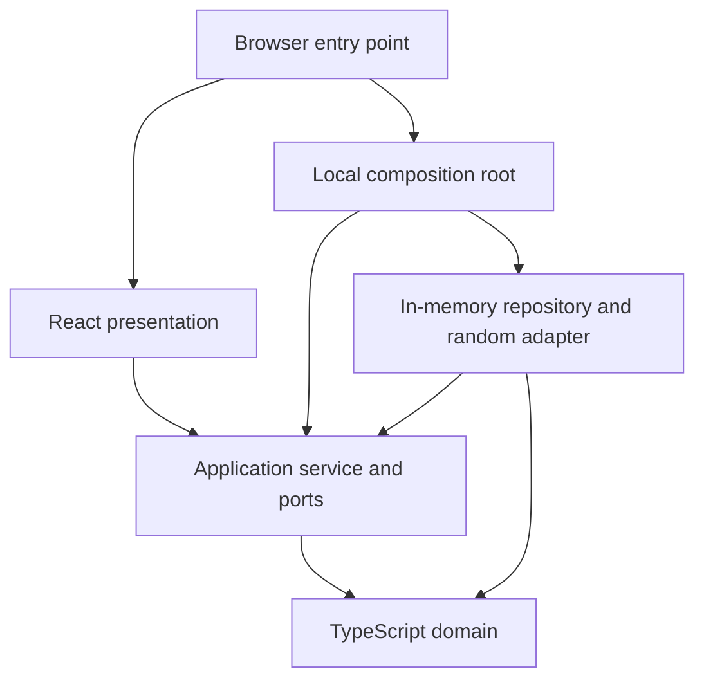

# Architecture

| Layer          | Responsibilities                                                  | Allowed project dependencies             |
| -------------- | ----------------------------------------------------------------- | ---------------------------------------- |
| Domain         | Deck, matching, commands, turn state, events and errors           | Domain                                   |
| Application    | Run use cases, commit accepted transitions, return projections    | Application, domain                      |
| Infrastructure | Implement repository and randomness contracts                     | Infrastructure, application, domain      |
| Presentation   | Render projections, collect intentions, cover hands between turns | Presentation, application                |
| Composition    | Construct the service with concrete adapters                      | Composition, application, infrastructure |

Other cross-layer imports are forbidden. ESLint enforces the matrix, bars package imports in domain and application, and disallows common browser globals and direct `Math.random()` calls in those layers. The engine can execute in a plain TypeScript runtime.

The local root constructs a repository and supplies it and a random source to `createLocalGameService`. Infrastructure satisfies the application interfaces through typed return values. The service adapts `RandomSource.next` to the engine's random function and saves only successful results. The in-memory adapter replaces its snapshot synchronously. The engine computes a new snapshot using local copies and shares unchanged structures internally.

React receives use cases, detached projections, and public events. The local application always projects the first seat for the human and uses the acting bot’s own projection to choose a legal command. React paces bot commands with a cancellable timer. The table projection contains card counts and the top discard. The player projection adds only the requested hand and domain-derived legal actions. Projection tests check for hidden card IDs and verify that editing a returned hand leaves the stored hand intact.

The UI consumes the same action availability the engine validates, and only supplies display labels and rule explanations. The domain, projection and adapter contracts share card and snapshot types. React uses application types for card display and action feedback, so a new card type can require corresponding presentation work. The lint check covers import direction. Tests and review verify behavioral responsibilities such as rule ownership and keeping authoritative snapshots out of UI state.

## Online extension

Early scoring is a domain command with an explicit result reason and winning seats. The table projection exposes that result and public hand counts. Leaving a local match clears the repository through its application port and produces no match result.

Run the same engine and player projection on a server. A WebSocket adapter should decode and validate incoming data and map verified seat credentials to the command actor. A room service should serialize commands or atomically commit against a room revision, then distribute separate projections to each seat. A room code locates a room and a separate seat credential enables reconnecting to the same hand. The server can restore the current projection on reconnect, expire idle rooms, and let optional bots choose from legal actions and submit ordinary commands. Room lifecycle, authorization, transport and storage belong outside the engine. The local application uses a single-match repository for bot play.
