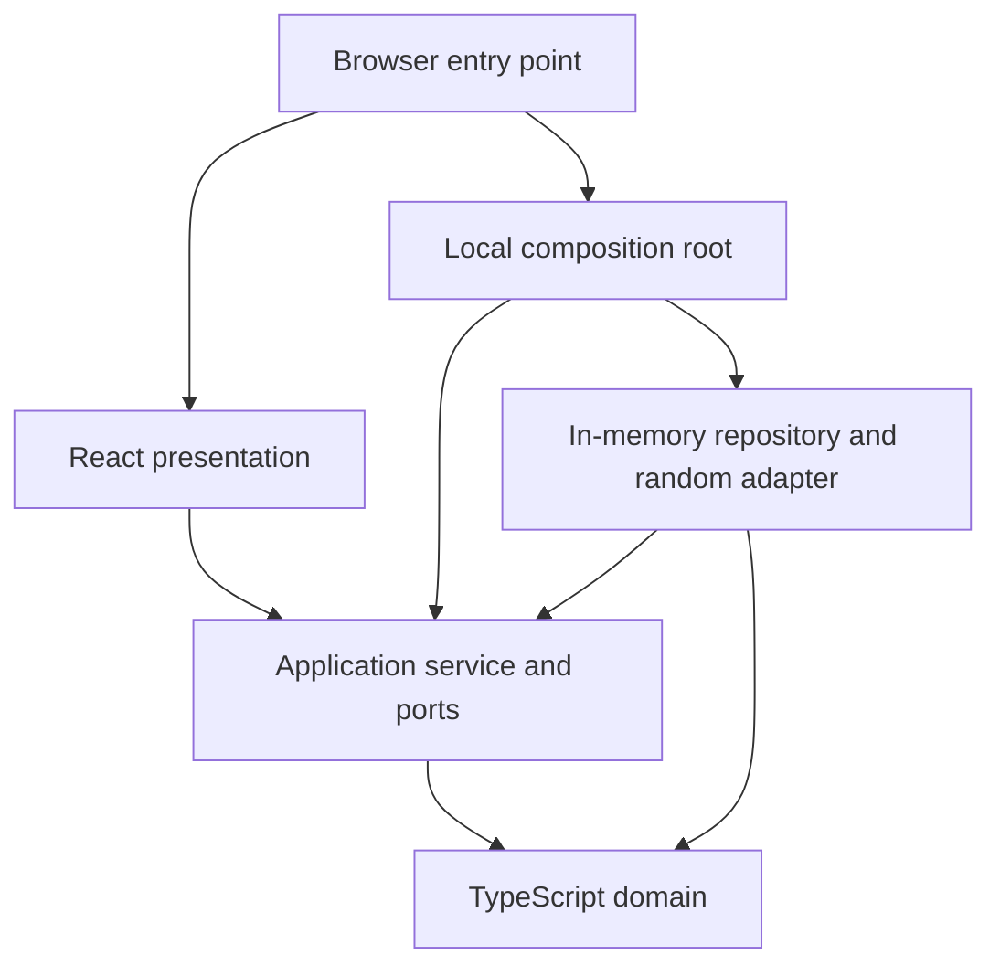
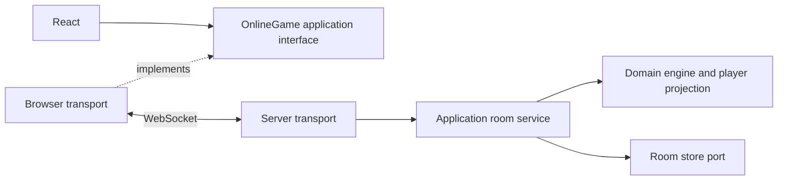

# Architecture

| Layer          | Responsibilities                                               | Allowed project dependencies             |
| -------------- | -------------------------------------------------------------- | ---------------------------------------- |
| Domain         | Deck, matching, commands, turn state, events and errors        | Domain                                   |
| Application    | Run use cases, commit accepted transitions, return projections | Application, domain                      |
| Infrastructure | Implement storage, randomness, and networking contracts        | Infrastructure, application, domain      |
| Presentation   | Render projections and collect intentions                      | Presentation, application                |
| Composition    | Construct the service with concrete adapters                   | Composition, application, infrastructure |

Other cross-layer imports are forbidden. ESLint enforces the matrix, bars package imports in domain and application, and disallows common browser globals and direct `Math.random()` calls in those layers. The engine can execute in a plain TypeScript runtime.

The local root constructs a repository and supplies it and a random source to `createLocalGameService`. Infrastructure satisfies the application interfaces through typed return values. The service adapts `RandomSource.next` to the engine's random function and saves only successful results. The in-memory adapter replaces its snapshot synchronously. The engine computes a new snapshot using local copies and shares unchanged structures internally.

React receives use cases, detached projections, and public events. The local application always projects the first seat for the human and uses the acting bot’s own projection to choose a legal command. React paces bot commands with a cancellable timer. The table projection contains card counts and the top discard. The player projection adds only the requested hand and domain-derived legal actions. Projection tests check for hidden card IDs and verify that editing a returned hand leaves the stored hand intact.

The UI consumes the same action availability the engine validates, and only supplies display labels and rule explanations. The domain, projection and adapter contracts share card and snapshot types. React uses application types for card display and action feedback, so a new card type can require corresponding presentation work. The lint check covers import direction. Tests and review verify behavioral responsibilities such as rule ownership and keeping authoritative snapshots out of UI state.

The engine supplies legal number groups and penalty actions in the player projection. The board owns only the selection and sends one batch intent. The WebSocket decoder checks intent shape, then the same engine validates the entire batch or penalty decision at the room's current revision. The pending penalty kind and count are public match state. Stack availability and grouped card IDs are seat-specific.

## Online rooms

The browser composition root supplies a WebSocket adapter through the OnlineGame interface. React sees typed room views, connection status, and player intentions. The transport owns wire serialization, reconnect scheduling, and tab-scoped credential storage. The server composition root supplies the room service with in-memory storage, cryptographic code and token generators, a clock, and random draws.

Each six-character code locates a room. A separate 256-bit bearer credential identifies a seat and is sent only on that seat’s socket. The server binds credentials to sockets, replaces older connections on resume, and derives actor IDs from the binding. The protocol decoder keeps only recognized action fields. Each accepted action checks the latest room revision and updates the room synchronously before any broadcast. Stale requests return a fresh projection and a retry message. Each socket receives a separately projected view; public events contain played cards and draw counts only.

The host starts after two to four connected seats are ready. Disconnected seats stay reserved. An explicit lobby departure frees the seat and transfers host duties if necessary. An explicit departure during a match revokes the credential and marks the seat offline. Any seated player can confirm the early scoring house rule. Rooms expire after an hour without room activity. A single process owns all rooms and its restart clears them. Multiple server processes would require coordinated room ownership or transactional storage.

Bot mode uses the same engine, projections, and match intents with a single in-memory match. The UI fixes the human to one seat and paces bots using a cancellable timer. Bot strategy receives the acting seat’s projection. Browser memory contains the local authoritative match, while online authority and hidden information remain on the server.
